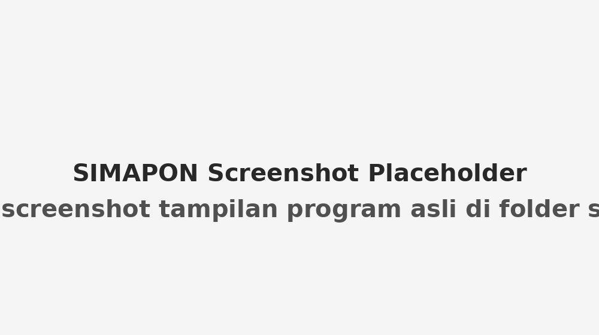

# 🕌 SIMAPON - Sistem Monitoring Santri


**SIMAPON** adalah aplikasi web berbasis Django untuk memantau data santri, pembayaran SPP, perizinan, dan catatan sikap. Aplikasi ini dibuat sebagai sistem informasi terintegrasi untuk guru, wali murid, dan administrator pondok pesantren.

---

## 👥 Anggota Kelompok

1. Nama Anggota 1
2. Nama Anggota 2
3. Nama Anggota 3

> *Silakan ganti nama anggota di atas dengan nama kelompok yang sebenarnya.*

---

## ✨ Fitur Utama

- **Registrasi & Login Multirole**: Kontrol akses menggunakan custom user model untuk Admin, Guru, dan Wali Murid.
- **Dashboard Kustom**: Tampilan dashboard khusus dan fungsional untuk setiap peran pengguna.
- **Manajemen Santri**: Pengelolaan data santri terpusat dengan fitur import/export terintegrasi cerdas.
- **Perizinan Santri**: Sistem pengajuan perizinan oleh guru/wali dan persetujuan dari admin.
- **Catatan Sikap**: Rekam jejak perilaku santri selama di pondok pesantren.
- **Keuangan & SPP**: Pemantauan pembayaran SPP dilengkapi dengan fitur unggah status bukti transfer.
- **Import Data (Excel/CSV)**: Form cerdas untuk import data santri dan pengguna secara massal.

---

## 🚀 Cara Menjalankan Project

### 1. Persiapan Lingkungan

Pastikan Anda telah menginstal **Python 3** di sistem Anda.

Masuk ke direktori proyek SIMAPON:
```bash
cd /path/to/SIMAPON
```

### 2. Konfigurasi Virtual Environment

Sangat disarankan menggunakan virtual environment untuk menghindari konflik dependensi.

**Untuk Windows:**
```cmd
python -m venv venv_windows
venv_windows\Scripts\activate
```

**Untuk Linux/macOS:**
```bash
python3 -m venv venv_linux
source venv_linux/bin/activate
```

### 3. Instalasi Dependensi & Setup Database

Setelah virtual environment aktif, instal library yang dibutuhkan:
```bash
pip install -r requirements.txt
```

Jalankan migrasi database:
```bash
python manage.py migrate
```

*(Opsional)* Buat akun superuser untuk mengakses halaman Admin:
```bash
python manage.py createsuperuser
```

### 4. Menjalankan Server Development

Jalankan server aplikasi:
```bash
python manage.py runserver 0.0.0.0:8000
```
Buka browser dan akses aplikasi melalui: **http://localhost:8000** atau **http://127.0.0.1:8000**

> **TIPS: Publikasi ke Internet (Tunneling)**
> Jika Anda ingin agar aplikasi bisa diakses melalui internet publik (misal untuk demonstrasi), buka terminal baru dan jalankan Cloudflared:
> ```bash
> cloudflared tunnel --url http://localhost:8000
> ```

---

## 🏗️ Implementasi OOP

Aplikasi ini dibangun menggunakan konsep **Object-Oriented Programming (OOP)** secara komprehensif pada framework Django:

- **Inheritance (Pewarisan)**
  - `User` mewarisi dari `django.contrib.auth.models.AbstractUser`.
  - Model sistem (contoh: `Student`, `Payment`) mewarisi `models.Model`.
  - Form sistem (contoh: `StudentForm`, `PaymentForm`) mewarisi `forms.ModelForm`.
- **Encapsulation (Enkapsulasi)**
  - Model menyembunyikan detail penyimpanan dan menyediakan antarmuka validasi.
  - View memproses HTTP request/response tanpa mengekspos state internal ke pengguna.
- **Abstraction (Abstraksi)**
  - Model merepresentasikan data bisnis tanpa mengharuskan penulisan query SQL mentah.
  - Form mengabstraksi pembuatan elemen HTML dan proses validasi kompleks.
- **Polymorphism (Polimorfisme)**
  - Metode `is_valid()` dan `save()` beroperasi secara identik pada berbagai kelas form yang berbeda, memberikan antarmuka yang seragam.
  - Override method dari kelas induk (`django.contrib.admin.ModelAdmin`) untuk menyesuaikan aksi dan tampilan kustom admin.

---

## 📂 Struktur Folder Penting

- `SIMAPON/` : Konfigurasi utama Django project.
- `users/`, `students/`, `finance/`, `permits/`, `behavior/` : Modul-modul aplikasi (Django Apps).
- `templates/` : File HTML dan desain layout halaman.
- `static/` : Aset statis seperti CSS, JavaScript, dan gambar.

---

## 📸 Screenshot Tampilan Program



> *Tambahkan tangkapan layar aplikasi yang relevan pada `screenshots/screenshot.png` untuk memperlihatkan antarmuka sistem secara utuh.*
