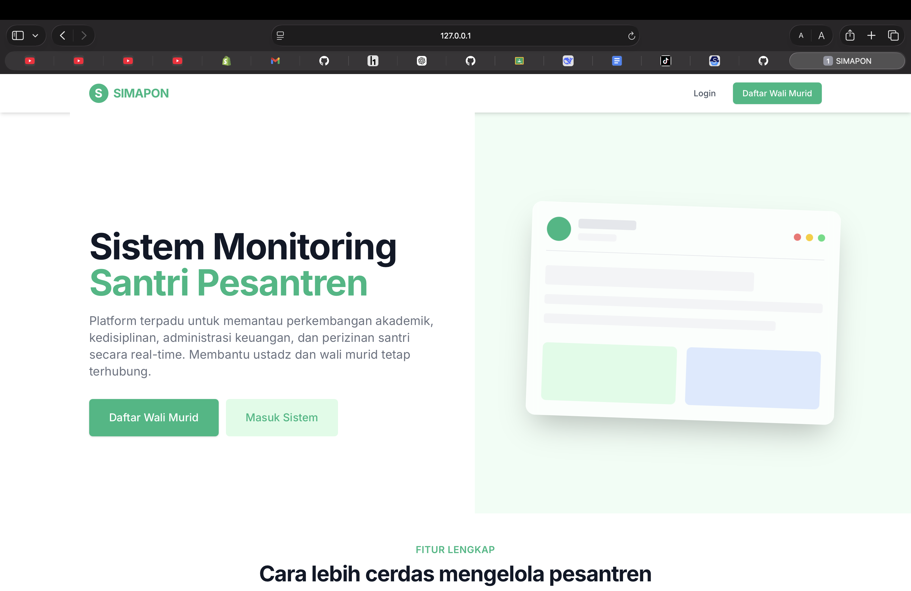
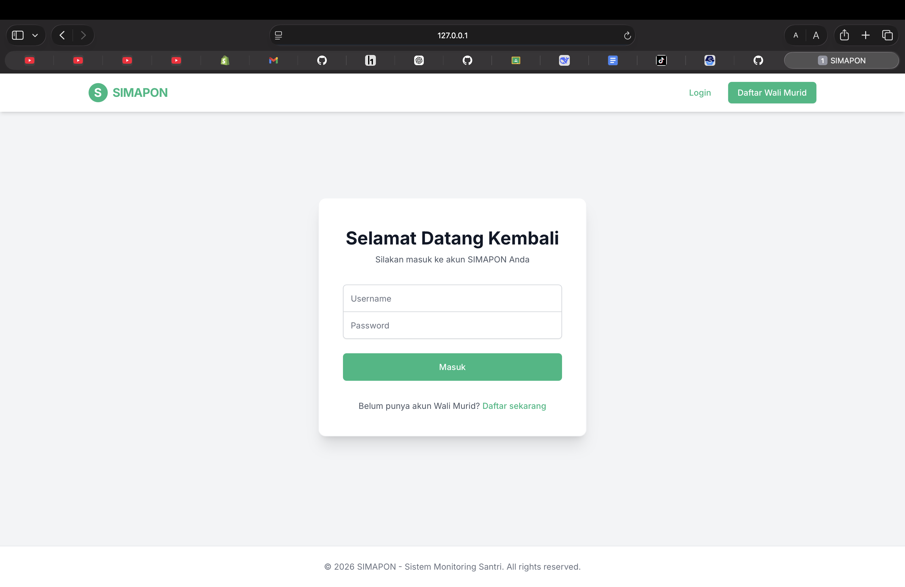
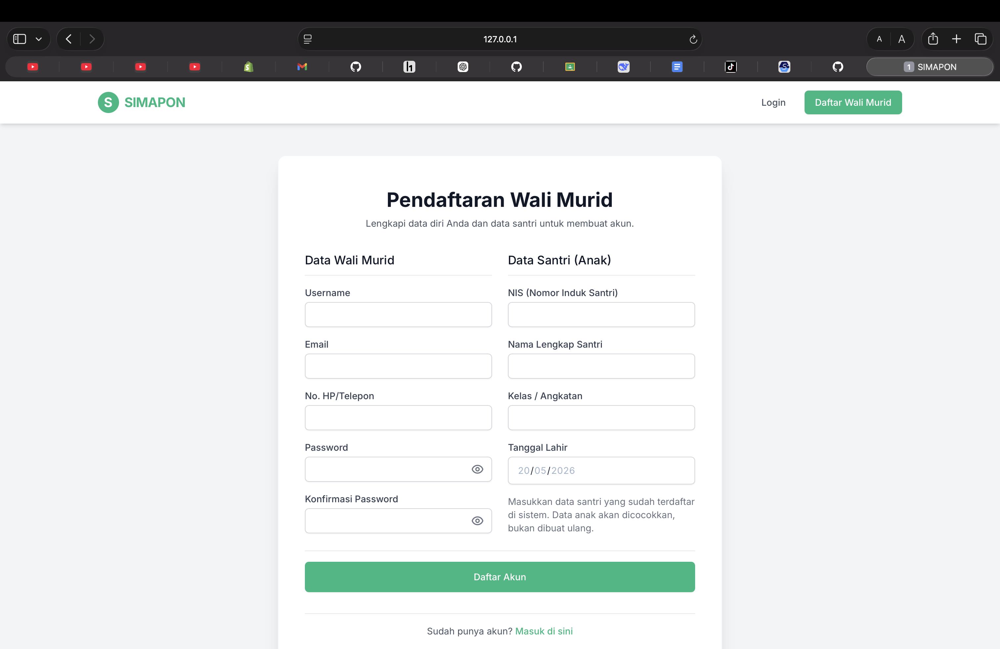
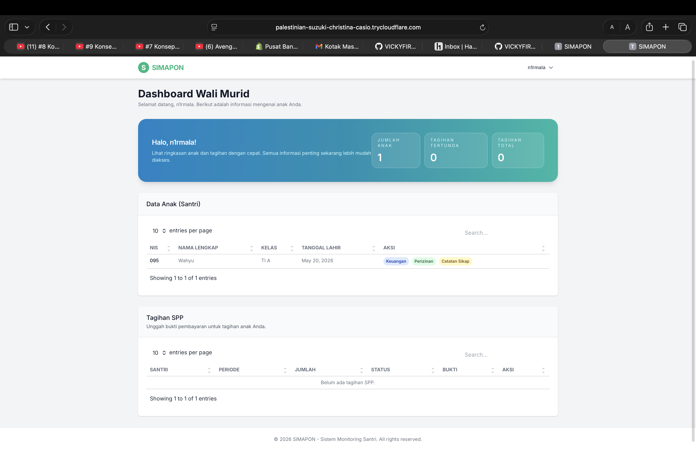

# 🕌 SIMAPON — Sistem Monitoring Santri (Parent Monitoring System)


[](LICENSE)


<p align="center">
  <strong>Languages:</strong> English (default) · <a href="#readme-id">Bahasa Indonesia</a>
</p>

<a id="readme-en"></a>

<p align="center">
  <a href="https://www.unesa.ac.id/" title="State University of Surabaya">
    
  </a>
</p>

<p align="center">
  <strong>Object-Oriented Programming — coursework / project</strong><br />
  <a href="https://www.unesa.ac.id/">State University of Surabaya (UNESA)</a>
</p>

---

**SIMAPON** (Sistem Monitoring Santri) is an integrated Django-based parent monitoring web application designed for boarding schools (Pondok Pesantren). It enables real-time tracking of student academic and behavioral progress, monthly tuition payments (SPP), leave permits, and custom behavioral conduct logs, acting as a seamless communication bridge between administrators, teachers, and parents.

---

## 📸 Preview & Screenshots

Explore the user interface and main features of the **SIMAPON** web application below:

### 1. Landing Page (Halaman Utama)
A welcoming portal with modern branding introducing the boarding school environment and key platform highlights.
<p align="center">
  
</p>

### 2. Multi-Role Authentication
Secured entry pages allowing administrators, teachers, and parents to access their respective system dashboards.
<p align="center">
  
  
</p>

### 3. Parent Monitoring Dashboard (Dashboard Wali)
A tailored, information-rich view for parents displaying real-time tracking of SPP payments, active leave permissions, and conduct logs.
<p align="center">
  
</p>

---

## ✨ Core Features

- 🔐 **Multi-Role Authentication**: Customized dashboard and access control system for Admins, Teachers (Guru), and Parents (Wali).
- 📊 **Dynamic Dashboards**: Interactive metrics highlighting active permissions, payment history, and recent conduct records.
- 👨‍🎓 **Comprehensive Student Management**: Dynamic data entry, student registration profiles, and central database indexing.
- 📝 **Leave Permits System**: Digital permit requesting for parents/teachers with real-time approval status workflow handled by administrators.
- 📈 **Conduct Tracking**: Behavior log detailing positive behaviors and infraction reports to evaluate student character development.
- 💳 **Tuition & Finance (SPP)**: Easy upload of payment receipts for verification, tuition schedule lists, and dynamic status updates.
- 📥 **Bulk Import via Excel**: Excel parser built with `openpyxl` allowing rapid, bulk imports of student and user registry databases.

---

## 🏗️ Object-Oriented Programming (OOP) Implementation

**SIMAPON** is built on top of the Django framework, strictly adhering to core OOP principles to ensure maintainability, scalability, and code reuse:

- **🧬 Inheritance (Pewarisan)**
  - `User` inherits from `django.contrib.auth.models.AbstractUser` to implement customized multi-role authentication attributes.
  - Core database entities (`Student`, `Payment`, `LeavePermit`, `BehaviorRecord`) inherit from `models.Model`, gaining robust ORM methods.
  - Form validation classes (e.g., `StudentForm`, `PaymentForm`) inherit from Django’s class-based forms `forms.ModelForm`.
- **🔒 Encapsulation (Enkapsulasi)**
  - Data representation and transaction logic are safely packaged within the model classes, hiding implementation details from templates.
  - Controllers (Django Views) encapsulate request-handling routines, processing input payloads and returning specific responses while protecting internal data states.
- **👁️ Abstraction (Abstraksi)**
  - Django ORM abstracts deep, raw SQL queries into clean Python objects, protecting the application layer from changes in database engines.
  - Django forms abstract raw HTML component generation and client/server validation routines into high-level declarative logic.
- **🎭 Polymorphism (Polimorfisme)**
  - Standardized methods like `is_valid()` and `save()` operate polymorphic behaviors across distinct form types.
  - Overriding standard Django Admin methods (e.g., `ModelAdmin`) to dynamically construct access patterns, form views, and layout options based on roles.

---

## 📂 Project Structure

```
SIMAPON-ParentMonitoringSystem/
├── manage.py                          # Django command-line execution entry point
├── db.sqlite3                         # Local development SQLite3 database file
├── requirements.txt                   # Project package dependencies
├── run.txt                            # Command reference sheet for local/public runs
├── XLSX_FORMAT.md                     # Documentation for bulk upload Excel formats
├── Data Dummy Guru Website SIMAPON.xlsx  # Sample teacher directory database
├── Data Dummy Santri Website SIMAPON.xlsx  # Sample student directory database
├── .gitignore
│
├── SIMAPON/                           # Core configuration directory
│   ├── __init__.py
│   ├── settings.py                    # Project configuration, database setup, installed apps
│   ├── urls.py                        # Root URL routing pathways
│   ├── wsgi.py                        # WSGI entrypoint for production deployment
│   └── asgi.py                        # ASGI entrypoint for production deployment
│
├── users/                             # App: Custom users, multi-role auth, and dashboard controllers
│   ├── admin.py                       # Regulates custom user views on Django Admin
│   ├── apps.py
│   ├── forms.py                       # Registration, login, and profile forms
│   ├── models.py                      # Custom User model defining Admin, Guru, Wali
│   ├── urls.py                        # Route endpoints for auth services
│   └── views.py                       # Business logic for auth, registration, and dashboard dispatch
│
├── students/                          # App: Student registry, profiles, and data import logic
│   ├── admin.py
│   ├── apps.py
│   ├── forms.py                       # Forms for student entries
│   ├── models.py                      # Student database schema (`Student` model)
│   └── views.py                       # Student data listing views
│
├── finance/                           # App: Tuition management and payment verification
│   ├── admin.py
│   ├── apps.py
│   ├── forms.py                       # Forms for payment proof upload
│   ├── models.py                      # SPP invoice schema (`Payment` model)
│   └── views.py                       # SPP status verification controller views
│
├── permits/                           # App: Leave request generation & approval system
│   ├── admin.py
│   ├── apps.py
│   ├── forms.py                       # Request and approval workflows forms
│   ├── models.py                      # Leave permission schema (`LeavePermit` model)
│   └── views.py                       # Leave workflow processing view actions
│
├── behavior/                          # App: Student conduct tracking & behavioral scoring
│   ├── admin.py
│   ├── apps.py
│   ├── forms.py                       # Forms for conduct record inputs
│   ├── models.py                      # Conduct record schema (`Behavior` model)
│   └── views.py                       # Conduct record views
│
├── templates/                         # HTML structure templates
│   ├── base.html                      # Main HTML scaffold & dynamic navbar layout
│   ├── index.html                     # Root portal redirect view
│   ├── landing.html                   # Interactive home interface
│   ├── dashboards/                    # Customized role-based dashboards
│   │   ├── admin_base.html            # Main base dashboard scaffold for administrators
│   │   ├── admin.html                 # Admin center home overview
│   │   ├── admin_santri.html          # Admin view for student database
│   │   ├── admin_guru.html            # Admin view for teacher registry
│   │   ├── admin_parent.html          # Admin view for parents registry
│   │   ├── admin_finance.html         # Admin view for tuition dashboard
│   │   ├── admin_permit.html          # Admin view for student permit review
│   │   ├── admin_behavior.html        # Admin view for student conduct log
│   │   ├── edit_*.html                # Target record update views
│   │   ├── guru.html                  # Dashboard view tailored for teachers
│   │   └── parent.html                # Parent student monitoring dashboard
│   └── registration/
│       ├── login.html                 # Custom user auth login screen
│       └── register.html              # Dynamic multi-role registration form
│
└── screenshots/                       # Preview illustrations
    ├── HalamanUtama.png
    ├── HalamanLogin.png
    ├── HalamanPendaftaran.png
    └── DashboardWali.png
```

---

## 🛠️ System Requirements

Ensure the following development dependencies are installed on your environment:
- **Python 3.12+**
- **pip** (Python package installer)
- **Git**

---

## 🚀 Installation & Setup

Follow these steps to run the application locally on your machine:

### 1. Clone the Repository
```bash
git clone https://github.com/VICKYFIRNANSYAH/SIMAPON-ParentMonitoringSystem.git
cd SIMAPON-ParentMonitoringSystem
```

### 2. Configure Virtual Environment

Set up a virtual environment to manage dependencies securely without conflicts:

**For Windows:**
```cmd
python -m venv venv_windows
venv_windows\Scripts\activate
```

**For Linux / macOS:**
```bash
python3 -m venv venv_linux
source venv_linux/bin/activate
```

### 3. Install Dependencies
```bash
pip install -r requirements.txt
```

### 4. Database Setup & Migrations
Create the SQLite database schema structures:
```bash
python manage.py migrate
```

*(Optional)* Create an initial administrative superuser profile:
```bash
python manage.py createsuperuser
```

### 5. Start the Development Server
Launch the Django server:
```bash
python manage.py runserver 0.0.0.0:8000
```
Open your browser and navigate to: **[http://localhost:8000](http://localhost:8000)** or **[http://127.0.0.1:8000](http://127.0.0.1:8000)**

---

## 🌐 Public Tunneling (Optional Dev Feature)

To share the application over the public internet (for demos, evaluations, or external parent testing) without deployment hosting:
1. Ensure the development server is active.
2. Open a new terminal session, and execute Cloudflared:
```bash
cloudflared tunnel --url http://localhost:8000
```

---

## 📄 License & Credits

- **Source Code**: Licensed under the **MIT License** — see [LICENSE](LICENSE) for details.
- **UNESA Logo**: Sourced from [Wikimedia Commons](https://commons.wikimedia.org/wiki/File:State_University_of_Surabaya_logo.png) (**CC BY-SA 4.0**). Trademarks belong to the Universitas Negeri Surabaya.
- **Technologies**: Powered by the Django web framework, openpyxl for Excel sheet parsing, and Pillow for image uploading validation.

---

## 👥 Authors & Team Members

This project was developed by:

| Avatar | Member | Role / Responsibilities | GitHub Profile |
|:---:| :--- | :--- | :--- |
|  | **Muhammad Vicky Firnansyah**<br />`25051204089` | Group Lead, Architecture, Multi-role Dashboards | [@VICKYFIRNANSYAH](https://github.com/VICKYFIRNANSYAH) |
|  | **M. Wahyu Setya Agung**<br />`25051204095` | Financial System & Excel Parser Integration | [@24wahyus-creator](https://github.com/24wahyus-creator) |
|  | **Aldio Khasy Shiham**<br />`25051204238` | Permits Workflow & Character Score Logs | [@aldiokhasy](https://github.com/aldiokhasy) |
|  | **Ahmad Syaifulloh**<br />`25051204385` | Database Optimization & Technical Documentation | [@ahmadsyaifulloh274-ai](https://github.com/ahmadsyaifulloh274-ai) |

---

<a id="readme-id"></a>

## Bahasa Indonesia

<p align="center"><a href="#readme-en">↑ Kembali ke Bahasa Inggris</a></p>

**SIMAPON** (Sistem Monitoring Santri) adalah aplikasi pemantauan santri berbasis web yang dibangun dengan framework Django. Sistem ini dirancang untuk mempermudah komunikasi serta pemantauan akademik, kehadiran, perizinan, riwayat keuangan (SPP), dan catatan perkembangan perilaku santri secara langsung oleh para orang tua/wali murid, guru, dan administrator pondok pesantren.

---

## 📸 Pratinjau & Tangkapan Layar

Berikut adalah tampilan antarmuka dan fitur-fitur utama dari sistem **SIMAPON**:

### 1. Halaman Utama (Landing Page)
Pintu masuk portal interaktif yang menyajikan pengenalan pondok pesantren dan menu navigasi login pengguna.
<p align="center">
  
</p>

### 2. Autentikasi Multi-Role
Halaman masuk aman yang membatasi hak akses sistem untuk masing-masing peran (Admin, Guru, Wali).
<p align="center">
  
  
</p>

### 3. Dashboard Wali Murid (Dashboard Wali)
Pusat pemantauan khusus bagi wali murid untuk melacak pembayaran SPP, status perizinan aktif, dan rekaman sikap santri.
<p align="center">
  
</p>

---

## ✨ Fitur Utama

- 🔐 **Registrasi & Login Multi-role**: Hak akses kustom terenkapsulasi untuk Admin, Guru, dan Wali Murid.
- 📊 **Dashboard Dinamis**: Tampilan grafis interaktif dan data ringkasan instan sesuai dengan peran pengguna.
- 👨‍🎓 **Manajemen Data Santri**: Manajemen rekap data santri terpusat dengan penyusunan profil lengkap.
- 📝 **Sistem Perizinan Santri**: Pengajuan izin keluar santri oleh wali murid, disertai alur verifikasi langsung oleh Admin.
- 📈 **Catatan Perilaku (Sikap)**: Pencatatan rekam perilaku (prestasi dan pelanggaran) santri selama di lingkungan pondok pesantren.
- 💳 **Manajemen Keuangan SPP**: Fitur upload bukti transfer oleh wali murid, rekapitulasi tagihan, dan verifikasi status pembayaran oleh Admin.
- 📥 **Impor Excel Praktis**: Integrasi parser Excel menggunakan `openpyxl` untuk unggah massal data santri dan pengguna.

---

## 🏗️ Implementasi Object-Oriented Programming (OOP)

Aplikasi **SIMAPON** dirancang dengan menerapkan pilar utama konsep pemrograman berorientasi objek (OOP) di dalam arsitektur Django:

- **🧬 Inheritance (Pewarisan)**
  - Kelas `User` mewarisi dari `django.contrib.auth.models.AbstractUser` untuk membangun otentikasi multi-role.
  - Kelas data model (`Student`, `Payment`, `LeavePermit`, `BehaviorRecord`) mewarisi fungsionalitas ORM dari `models.Model`.
  - Struktur form validasi (contoh: `StudentForm`, `PaymentForm`) mewarisi kelas bawaan Django `forms.ModelForm`.
- **🔒 Encapsulation (Enkapsulasi)**
  - Semua operasi manipulasi basis data dan atribut entitas dibungkus rapi dalam kelas Model, membatasi akses langsung yang tidak aman.
  - Kelas Views (Controller) mengemas seluruh alur proses *request* dan pembuatan *response* tanpa memperlihatkan state internal sistem kepada pengguna.
- **👁️ Abstraction (Abstraksi)**
  - Django ORM mengabstraksi sintaksis SQL mentah menjadi manipulasi objek Python yang bersih dan terstandarisasi.
  - Django Forms mengabstraksi render komponen input HTML serta proses validasi formulir di sisi server.
- **🎭 Polymorphism (Polimorfisme)**
  - Metode `is_valid()` dan `save()` bekerja secara polimorfik di berbagai jenis form untuk melakukan tugas validasi dan penyimpanan data yang seragam.
  - Melakukan override pada metode default kelas `ModelAdmin` untuk memodifikasi hak akses, layout, serta parameter filter di halaman admin.

---

## 📂 Struktur Proyek

Detail struktur file dan direktori sama seperti yang tertera pada bagian [**Project Structure**](#-project-structure) di atas.

---

## 🛠️ Persyaratan Sistem

Pastikan perangkat Anda memiliki dependensi berikut:
- **Python 3.12+**
- **pip** (Penginstal pustaka Python)
- **Git**

---

## 🚀 Instalasi & Menjalankan Program

Ikuti langkah-langkah di bawah ini untuk menjalankan SIMAPON di komputer Anda:

### 1. Klon Repositori
```bash
git clone https://github.com/VICKYFIRNANSYAH/SIMAPON-ParentMonitoringSystem.git
cd SIMAPON-ParentMonitoringSystem
```

### 2. Konfigurasi Virtual Environment

Sangat disarankan menggunakan virtual environment agar dependensi proyek tidak mengganggu library global:

**Di Windows:**
```cmd
python -m venv venv_windows
venv_windows\Scripts\activate
```

**Di Linux / macOS:**
```bash
python3 -m venv venv_linux
source venv_linux/bin/activate
```

### 3. Pasang Dependensi
```bash
pip install -r requirements.txt
```

### 4. Setup Database & Migrasi
Lakukan migrasi database untuk membangun skema tabel:
```bash
python manage.py migrate
```

*(Opsional)* Buat akun superuser sebagai akses administrator:
```bash
python manage.py createsuperuser
```

### 5. Jalankan Server Aplikasi
```bash
python manage.py runserver 0.0.0.0:8000
```
Buka browser Anda dan akses sistem melalui alamat: **[http://localhost:8000](http://localhost:8000)** atau **[http://127.0.0.1:8000](http://127.0.0.1:8000)**

---

## 🌐 Publikasi Sementara (Tunneling Cloudflared)

Jika ingin memperlihatkan web app ini ke jaringan publik agar dapat diakses oleh dosen penguji atau orang tua santri secara jarak jauh:
1. Pastikan server lokal tetap berjalan di terminal pertama.
2. Buka terminal baru, lalu jalankan perintah berikut:
```bash
cloudflared tunnel --url http://localhost:8000
```

---

## 📄 Lisensi & Kredit

- **Kode Sumber**: Berlisensi **MIT License** — silakan baca file [LICENSE](LICENSE) untuk informasi lengkap.
- **Logo UNESA**: Diambil dari [Wikimedia Commons](https://commons.wikimedia.org/wiki/File:State_University_of_Surabaya_logo.png) (**CC BY-SA 4.0**). Hak cipta milik Universitas Negeri Surabaya.
- **Pustaka**: Dibuat menggunakan framework web Django, openpyxl untuk import data excel, serta Pillow untuk kompresi dan upload berkas gambar.

---

## 👥 Tim Pengembang

Proyek ini dibangun dan dikembangkan oleh:

- **Muhammad Vicky Firnansyah** (`25051204089`) — Ketua Kelompok, Arsitektur Sistem, Desain Dashboard Multi-role — [@VICKYFIRNANSYAH](https://github.com/VICKYFIRNANSYAH)
- **M. Wahyu Setya Agung** (`25051204095`) — Integrasi Pembayaran & Parser Impor Excel — [@24wahyus-creator](https://github.com/24wahyus-creator)
- **Aldio Khasy Shiham** (`25051204238`) — Sistem Alur Perizinan & Rekap Sikap Santri — [@aldiokhasy](https://github.com/aldiokhasy)
- **Ahmad Syaifulloh** (`25051204385`) — Pengelolaan Database & Dokumentasi Teknis — [@ahmadsyaifulloh274-ai](https://github.com/ahmadsyaifulloh274-ai)

---

> Dibuat untuk pembelajaran Pemrograman Berorientasi Objek (PBO) dengan Django di Universitas Negeri Surabaya.
